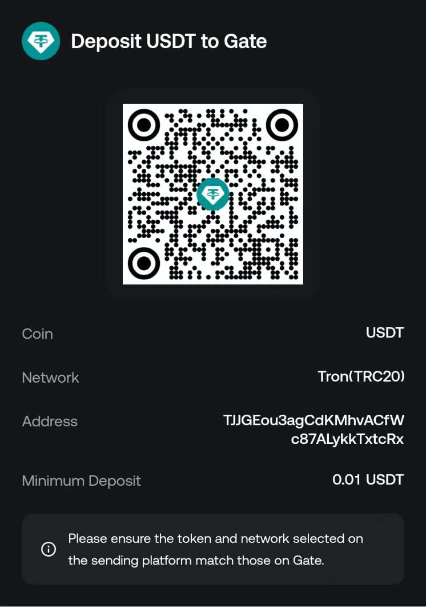

<p align="center">
  
</p>

<h1 align="center">TalyxTerminal</h1>

<p align="center"><b>Build limitless.</b></p>

<p align="center">
  <a href="../../LICENSE"></a>
  
  
  <a href="https://github.com/talyxterminal/TalyxTerminal/releases"></a>
  <a href="https://github.com/talyxterminal/TalyxTerminal/stargazers"></a>
  
</p>

<p align="center">
  <a href="../../README.md">English</a> ·
  <a href="README.zh-CN.md">简体中文</a> ·
  <a href="README.zh-TW.md">繁體中文</a> ·
  <a href="README.ja.md">日本語</a> ·
  <a href="README.ko.md">한국어</a> ·
  <b>Español</b> ·
  <a href="README.ru.md">Русский</a>
</p>

**Una terminal financiera que funciona en tu propio ordenador y es abierta de principio a fin.**

Gráficos, investigación y una IA que vigila el mercado por ti, todo en un mismo espacio de trabajo. Tus datos se quedan en tu máquina y tus claves, en tus manos. Libre y de código abierto.

<p align="center"></p>

## Abierta por diseño

TalyxTerminal no es una gran aplicación monolítica. Es una plataforma ligera y un conjunto de módulos.

- **Los módulos oficiales no tienen privilegios.** Los módulos colaboran solo a través de lo que cada uno publica, y los oficiales usan los mismos contratos que los de terceros. Todo lo que construimos nosotros, también puedes construirlo tú.
- **Se puede ampliar por cualquier parte.** Añade una fuente de datos y Chart, Quant y Agent pueden usarla a la vez. Escribe un indicador y los gráficos, las alertas y los filtros lo entienden.
- **Personas e IA usan las mismas acciones.** Todo lo que puedes hacer en la interfaz también lo puede hacer la IA, y las herramientas de IA externas pueden conectarse por MCP para trabajar en el mismo espacio.
- **Community** es donde viven los módulos: cuáles existen, cuáles están instalados y dónde abrirlos.

<p align="center"></p>

El diseño se describe en [docs/architecture.md](../architecture.md) (en inglés).

## Módulos oficiales

**[Chart](../../modules/chart/README.md): gráficos y seguimiento del mercado.** Un gráfico al estilo de TradingView cuyos indicadores se escriben en Python.
- Decenas de indicadores integrados, más de una docena de tipos de gráfico (Heikin Ashi, Renko, Kagi, punto y figura…) y hasta ocho gráficos enlazados por espacio de trabajo
- Los indicadores son Python: todo lo que Pine puede expresar, y además bibliotecas como scikit-learn o PyTorch, para dibujar un modelo de aprendizaje automático directamente en el gráfico
- Alertas sobre precio, indicadores y dibujos; reproducción de barras; filtros que criban una lista de instrumentos según condiciones de indicadores

**[Quant](../../modules/quant/README.md): investigación cuantitativa y backtesting.** Todo el camino desde una idea hasta una estrategia en la que puedas confiar.
- Factores: escribe una fórmula de una línea y ve en segundos el IC, los rendimientos por cuantiles y la rotación
- Modelos: combina factores en una señal con aprendizaje automático, entrenada y validada en ventanas móviles (walk-forward)
- Backtests con el motor Nautilus, con comisiones, spread, impacto, préstamo de valores y costes de financiación; el resultado es un informe completo con curva de capital y drawdowns, periodos de crisis, atribución por estilos, costes y capacidad
- Asignación de carteras, cuadernos y una biblioteca que publica resultados de investigación y los mantiene actualizados para que las estrategias los usen

<p align="center"></p>

**[Agent](../../modules/agent/README.md): una IA que entiende tu espacio de trabajo.** Conecta el modelo que prefieras; trabaja con las mismas herramientas que tú.
- Pídele que descargue datos, cree gráficos, escriba indicadores o lance backtests, y deshaz sus cambios turno a turno
- Los bots tienen sus propias tareas, presupuestos y horarios: escribir el informe antes de la apertura, despertarse cuando salta una alerta o trabajar juntos en grupo
- Antes de actuar, pide permiso según los permisos que hayas configurado, y registra cuánto ha costado cada modelo y cada ejecución

<p align="center"></p>

**[Market](../../modules/market/README.md): la base de todos los datos de mercado.** Los demás módulos piden los datos a Market; de dónde vienen y cómo se guardan es cosa de Market.
- Acciones de EE. UU., acciones A de China y de Hong Kong, criptomonedas e índices, con fuentes gratuitas que funcionan desde el primer momento
- Las lecturas empiezan por tu propia máquina, así que los datos guardados siguen disponibles sin conexión
- Añade la clave de una fuente de pago y Market cambia a la mejor fuente; no hay que tocar nada más

**[Developer](../../modules/developer/README.md): donde se escriben módulos e indicadores.** Código, documentación y ejemplos en un mismo lugar, con depuración con puntos de interrupción en VS Code.

## Guía de uso

La guía explica cómo instalar TALYX y usar cada módulo. Está disponible en [inglés](../user-guide.md) y en [chino simplificado](../user-guide.zh-CN.md).

## Inicio rápido

Descarga el instalador desde [Releases](https://github.com/talyxterminal/TalyxTerminal/releases) y ejecútalo. O ejecútalo desde el código fuente:

```powershell
uv sync --python 3.13 --locked
npm --prefix web ci
.\.venv\Scripts\python.exe -m host.desktop
```

Por ahora es compatible con Windows x64. La instalación completa, incluidos los archivos de ejecución de Quant, está en [docs/development.md](../development.md) (en inglés).

## De dónde vienen los datos

TalyxTerminal obtiene los datos directamente de las fuentes, desde tu ordenador; nada pasa por nuestros servidores. Los datos descargados una vez se guardan localmente y después se leen desde ahí.

**Las criptomonedas** vienen de las API oficiales y los archivos históricos de los exchanges. Las velas de un minuto, las tasas de financiación, el interés abierto, la relación largos/cortos y el volumen tomador tienen historial completo, y los indicadores pueden leerlos directamente. Cada exchange llega hasta una fecha distinta, y algunos no son accesibles desde ciertas regiones.

**Datos de acciones para backtests**

- **Estados Unidos.** La lista gratuita de Nasdaq solo incluye las acciones que cotizan hoy. Si la usas para un backtest, quedarán fuera las empresas que después dejaron de cotizar. Con una clave de pago de Sharadar puedes incluir las acciones retiradas de bolsa para las que Sharadar tiene precios.
- **Acciones A de China.** Los datos gratuitos de Baostock incluyen acciones retiradas de bolsa. También puedes consultar qué empresas formaban parte del CSI 300, el CSI 500 y el SSE 50 cada semana. El backtest usa el sector que constaba en cada fecha. TALYX consulta la clasificación cada trimestre, así que un cambio puede tardar hasta un trimestre en reflejarse.
- **Sectores y ventas en corto.** Para Estados Unidos y Hong Kong, el backtest aplica el sector actual a todo el periodo. Los datos gratuitos no indican qué acciones se podían tomar prestadas cada día, así que el backtest supone que siempre puedes conseguir las que quieras vender en corto.

Cada fuente tiene sus propias condiciones de uso. Consulta [docs/limits.md](../limits.md) (en inglés).

## Hoja de ruta

Trade (operativa y ejecución en real) · Intel (noticias y eventos) · un mercado de módulos en Community

## Apoya el proyecto

Si TalyxTerminal te resulta útil, puedes invitar al autor a un café.

<table>
  <tr>
    <td align="center"><br>Alipay</td>
    <td align="center"><br>USDT · <b>solo TRC20</b><br><code>TJJGEou3agCdKMhvACfWc87ALykkTxtcRx</code></td>
  </tr>
</table>

Envía USDT solo por la red TRC20 (Tron). Las transferencias por cualquier otra red no se pueden recuperar.

## Licencia y agradecimientos

TalyxTerminal se distribuye bajo la licencia [Apache-2.0](../../LICENSE). Se apoya en muchos proyectos de código abierto, como TradingView Lightweight Charts, NautilusTrader, Qlib y PyneCore; consulta [NOTICE](../../NOTICE).

TalyxTerminal no constituye asesoramiento de inversión.
