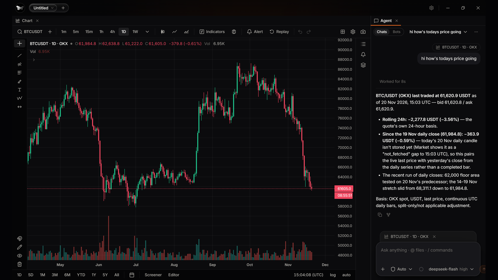
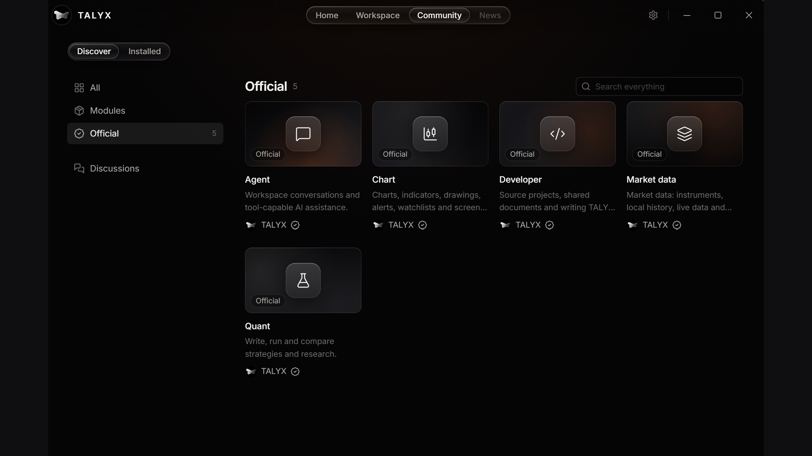
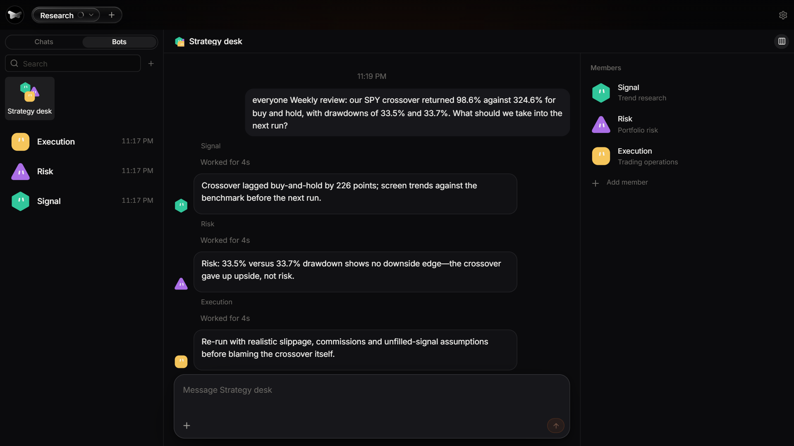

<p align="center">
  
</p>

<h1 align="center">TalyxTerminal</h1>

<p align="center"><b>Build limitless.</b></p>

<p align="center">
  <a href="../../LICENSE"></a>
  
  
  <a href="https://github.com/talyxterminal/TalyxTerminal/releases"></a>
  <a href="https://github.com/talyxterminal/TalyxTerminal/stargazers"></a>
  
</p>

<p align="center">
  <a href="../../README.md">English</a> ·
  <a href="README.zh-CN.md">简体中文</a> ·
  <a href="README.zh-TW.md">繁體中文</a> ·
  <a href="README.ja.md">日本語</a> ·
  <b>한국어</b> ·
  <a href="README.es.md">Español</a> ·
  <a href="README.ru.md">Русский</a>
</p>

**내 컴퓨터에서 실행되고, 처음부터 끝까지 열려 있는 금융 터미널.**

차트, 리서치, 그리고 시장을 대신 지켜보는 AI가 하나의 워크스페이스에 모여 있습니다. 데이터는 내 컴퓨터에, API 키는 내 손에. 무료 오픈소스입니다.

<p align="center"></p>

## 설계부터 개방형

TalyxTerminal은 하나의 거대한 애플리케이션이 아닙니다. 얇은 플랫폼과 여러 모듈로 이루어져 있습니다.

- **공식 모듈에 특권은 없습니다.** 모듈끼리는 각자 공개한 것을 통해서만 협력하고, 공식 모듈도 서드파티 모듈과 같은 계약을 씁니다. 우리가 만들 수 있는 것은 여러분도 만들 수 있습니다.
- **어디서든 확장할 수 있습니다.** 데이터 소스 하나를 추가하면 Chart, Quant, Agent가 모두 바로 쓸 수 있습니다. 지표를 하나 작성하면 차트, 알림, 스크리닝이 모두 이해합니다.
- **사람과 AI가 같은 동작을 씁니다.** 화면에서 할 수 있는 일은 AI도 할 수 있고, 외부 AI 도구도 MCP로 연결해 같은 워크스페이스에서 일할 수 있습니다.
- **Community**는 모듈이 사는 곳입니다. 어떤 모듈이 있는지, 무엇이 설치되어 있는지, 어디서 여는지 볼 수 있습니다.

<p align="center"></p>

설계에 대한 자세한 내용은 [docs/architecture.md](../architecture.md)(영문)에 있습니다.

## 공식 모듈

**[Chart](../../modules/chart/README.md): 차트와 시장 모니터링.** 지표를 Python으로 작성하는 TradingView 스타일의 차트.
- 수십 개의 내장 지표, 하이킨아시·렌코·카기·P&F를 포함한 십여 종의 차트 유형, 워크스페이스당 최대 8개의 연동 차트
- 지표는 Python: Pine으로 표현할 수 있는 것은 모두 쓸 수 있고, scikit-learn이나 PyTorch 같은 라이브러리도 쓸 수 있어 머신러닝 모델을 차트에 바로 그릴 수 있습니다
- 가격·지표·드로잉 알림, 바 리플레이, 지표 조건으로 종목 목록을 거르는 스크리닝

**[Quant](../../modules/quant/README.md): 퀀트 리서치와 백테스트.** 아이디어에서 믿을 수 있는 전략까지, 모든 과정을 여기서.
- 팩터: 한 줄짜리 수식을 쓰면 몇 초 만에 IC, 분위 수익률, 회전율을 확인
- 모델: 머신러닝으로 팩터를 결합해 신호를 만들고, 워크포워드 방식으로 학습·검증
- Nautilus 엔진 기반 백테스트. 수수료, 스프레드, 시장 충격, 대차 비용, 펀딩 비용을 반영하며, 결과는 자산 곡선과 낙폭, 위기 구간, 스타일 귀속, 비용, 운용 용량까지 담은 완전한 리포트
- 포트폴리오 배분, 노트북, 그리고 리서치 결과를 게시하고 계속 갱신해 전략이 쓸 수 있게 하는 라이브러리

<p align="center"></p>

**[Agent](../../modules/agent/README.md): 워크스페이스를 이해하는 AI.** 원하는 모델을 연결하면 여러분과 같은 도구로 일합니다.
- 데이터 가져오기, 차트 만들기, 지표 작성, 백테스트 실행을 맡길 수 있고, 변경 사항은 턴 단위로 되돌릴 수 있습니다
- Bot은 각자의 임무, 예산, 일정을 가집니다. 장 시작 전에 브리핑을 쓰고, 알림이 울리면 깨어나며, 여럿이 함께 협업할 수도 있습니다
- 행동하기 전에 여러분이 설정한 권한에 따라 허락을 구하고, 모델별·실행별 비용을 기록합니다

<p align="center"></p>

**[Market](../../modules/market/README.md): 모든 시장 데이터의 토대.** 다른 모듈은 Market에 데이터를 요청합니다. 데이터의 출처와 저장 방식은 Market이 맡습니다.
- 미국 주식, 중국 A주, 홍콩 주식, 암호화폐, 지수. 바로 쓸 수 있는 무료 데이터 소스 제공
- 읽기는 먼저 내 컴퓨터에서. 저장된 데이터는 오프라인에서도 쓸 수 있습니다
- 유료 데이터 소스의 키를 추가하면 Market이 더 좋은 소스로 전환합니다. 다른 것은 바꿀 필요가 없습니다

**[Developer](../../modules/developer/README.md): 모듈과 지표를 작성하는 곳.** 코드, 문서, 예제가 한곳에 있고, VS Code에서 중단점 디버깅도 할 수 있습니다.

## 사용 안내서

설치 방법과 모듈별 사용법은 [영문 안내서](../user-guide.md)와 [중국어 간체 안내서](../user-guide.zh-CN.md)에서 확인할 수 있습니다.

## 빠른 시작

[Releases](https://github.com/talyxterminal/TalyxTerminal/releases)에서 설치 파일을 내려받아 실행하세요. 소스에서 실행할 수도 있습니다:

```powershell
uv sync --python 3.13 --locked
npm --prefix web ci
.\.venv\Scripts\python.exe -m host.desktop
```

현재 Windows x64를 지원합니다. Quant 런타임 파일을 포함한 전체 설치 방법은 [docs/development.md](../development.md)(영문)에 있습니다.

## 데이터는 어디서 오나요

TalyxTerminal은 여러분의 컴퓨터에서 데이터 소스에 직접 접속합니다. 저희 서버를 거치지 않습니다. 한 번 가져온 데이터는 로컬에 저장되고 이후에는 거기서 읽습니다.

**암호화폐**는 각 거래소의 공식 API와 히스토리 파일에서 가져옵니다. 분봉, 펀딩비, 미결제약정, 롱/숏 비율, 테이커 거래량은 전체 기록이 있고, 지표에서 바로 읽을 수 있습니다. 거슬러 올라갈 수 있는 기간은 거래소마다 다르며, 일부 거래소는 지역에 따라 접속되지 않습니다.

**주식 백테스트를 할 때 알아둘 점**

- **미국 주식.** 나스닥 무료 종목 목록에는 현재 상장된 종목만 있습니다. 이 목록으로 과거 수익률을 계산하면 그사이 상장 폐지된 회사가 빠집니다. 유료 Sharadar 키를 등록하면 Sharadar에 가격 기록이 있는 상장 폐지 종목도 포함할 수 있습니다.
- **중국 A주.** Baostock 무료 데이터에는 상장 폐지 종목도 들어 있습니다. CSI 300, CSI 500, 상하이 50 지수에 어떤 종목이 속했는지도 주별로 확인할 수 있습니다. 백테스트는 당시 업종 분류를 사용합니다. TALYX가 분기마다 확인하므로 업종 변경이 반영되기까지 최대 한 분기가 걸릴 수 있습니다.
- **업종과 공매도.** 미국과 홍콩 주식은 과거 기간에도 현재 업종 분류를 적용합니다. 무료 데이터로는 특정 날짜에 어떤 주식을 빌릴 수 있었는지 알 수 없어, 백테스트에서는 공매도할 주식을 언제든 빌릴 수 있다고 가정합니다.

각 데이터 소스에는 고유한 이용 약관이 있습니다. [docs/limits.md](../limits.md)(영문)를 참고하세요.

## 로드맵

Trade(매매와 실전 운용) · Intel(뉴스와 이벤트) · Community 모듈 마켓플레이스

## 프로젝트 후원

TalyxTerminal이 도움이 되었다면, 작성자에게 커피 한 잔 사 주셔도 좋습니다.

<table>
  <tr>
    <td align="center"><br>Alipay</td>
    <td align="center"><br>USDT · <b>TRC20 전용</b><br><code>TJJGEou3agCdKMhvACfWc87ALykkTxtcRx</code></td>
  </tr>
</table>

USDT는 TRC20(트론) 네트워크로만 보내 주세요. 다른 네트워크로 보낸 금액은 복구할 수 없습니다.

## 라이선스와 감사의 말

TalyxTerminal은 [Apache-2.0](../../LICENSE) 라이선스로 배포됩니다. TradingView Lightweight Charts, NautilusTrader, Qlib, PyneCore를 비롯한 많은 오픈소스 프로젝트 위에 만들어졌습니다. 자세한 내용은 [NOTICE](../../NOTICE)를 참고하세요.

TalyxTerminal은 투자 조언이 아닙니다.
