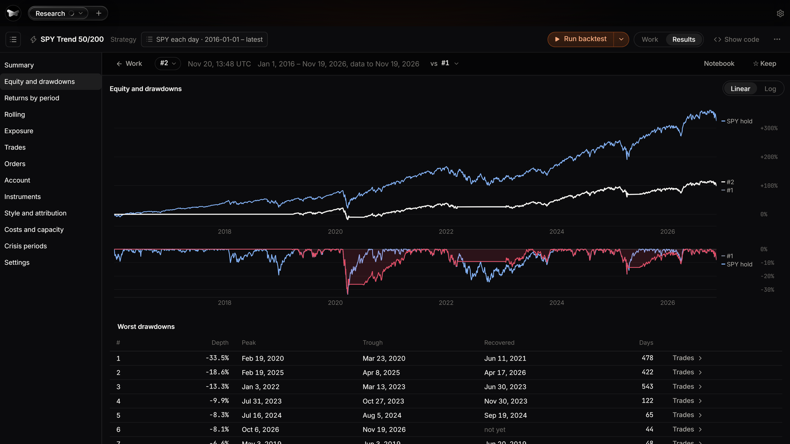

<p align="center">
  
</p>

<h1 align="center">TalyxTerminal</h1>

<p align="center"><b>Build limitless.</b></p>

<p align="center">
  <a href="../../LICENSE"></a>
  
  
  <a href="https://github.com/talyxterminal/TalyxTerminal/releases"></a>
  <a href="https://github.com/talyxterminal/TalyxTerminal/stargazers"></a>
  
</p>

<p align="center">
  <a href="../../README.md">English</a> ·
  <a href="README.zh-CN.md">简体中文</a> ·
  <a href="README.zh-TW.md">繁體中文</a> ·
  <a href="README.ja.md">日本語</a> ·
  <a href="README.ko.md">한국어</a> ·
  <a href="README.es.md">Español</a> ·
  <b>Русский</b>
</p>

**Финансовый терминал, который работает на вашем компьютере и открыт сверху донизу.**

Графики, исследования и ИИ, который следит за рынком вместо вас, — всё в одном рабочем пространстве. Ваши данные остаются на вашем компьютере, ключи — в ваших руках. Бесплатно и с открытым исходным кодом.

<p align="center"></p>

## Открытость в основе

TalyxTerminal — это не одно большое приложение, а тонкая платформа и набор модулей.

- **У официальных модулей нет привилегий.** Модули взаимодействуют только через то, что каждый из них публикует, и официальные модули используют те же контракты, что и сторонние. Всё, что можем сделать мы, можете сделать и вы.
- **Расширяйте где угодно.** Добавьте источник данных — и Chart, Quant и Agent сразу смогут им пользоваться. Напишите индикатор — и его поймут графики, оповещения и скринеры.
- **Люди и ИИ используют одни и те же действия.** Всё, что вы делаете в интерфейсе, может сделать и ИИ, а внешние ИИ-инструменты подключаются по MCP и работают в том же рабочем пространстве.
- **Community** — дом для модулей: какие модули есть, какие установлены и где их открыть.

<p align="center"></p>

Архитектура описана в [docs/architecture.md](../architecture.md) (на английском).

## Официальные модули

**[Chart](../../modules/chart/README.md): графики и наблюдение за рынком.** График в стиле TradingView, индикаторы для которого пишутся на Python.
- Десятки встроенных индикаторов, более десятка типов графиков, включая Heikin Ashi, Renko, Kagi и крестики-нолики, до восьми связанных графиков в рабочем пространстве
- Индикаторы — это Python: всё, что можно выразить на Pine, плюс библиотеки вроде scikit-learn или PyTorch, так что модель машинного обучения можно нарисовать прямо на графике
- Оповещения по цене, индикаторам и графическим объектам; воспроизведение баров; скринеры, отбирающие инструменты по условиям индикаторов

**[Quant](../../modules/quant/README.md): количественные исследования и бэктестинг.** Весь путь от идеи до стратегии, которой можно доверять.
- Факторы: напишите формулу в одну строку и через несколько секунд увидите IC, доходность по квантилям и оборачиваемость
- Модели: объединяйте факторы в сигнал с помощью машинного обучения, с обучением и проверкой методом walk-forward
- Бэктесты на движке Nautilus с учётом комиссий, спреда, влияния на рынок, стоимости заимствования и фондирования; результат — полный отчёт с кривой капитала и просадками, кризисными периодами, атрибуцией по стилям, издержками и ёмкостью
- Распределение портфеля, блокноты и библиотека, которая публикует результаты исследований и поддерживает их актуальными для стратегий

<p align="center"></p>

**[Agent](../../modules/agent/README.md): ИИ, который понимает ваше рабочее пространство.** Подключите модель на свой выбор — она работает теми же инструментами, что и вы.
- Попросите загрузить данные, построить графики, написать индикаторы или запустить бэктесты, а его изменения можно отменять по шагам
- У ботов свои обязанности, бюджеты и расписания: подготовить сводку до открытия рынка, проснуться при срабатывании оповещения или работать вместе группой
- Прежде чем действовать, он спрашивает разрешения в соответствии с вашими настройками и записывает, сколько стоила каждая модель и каждый запуск

<p align="center"></p>

**[Market](../../modules/market/README.md): основа всех рыночных данных.** Другие модули запрашивают данные у Market; откуда они берутся и как хранятся — забота Market.
- Акции США, китайские акции класса A, акции Гонконга, криптовалюты и индексы с бесплатными источниками, которые работают сразу
- Чтение начинается с вашего компьютера, поэтому сохранённые данные доступны и без сети
- Добавьте ключ платного источника — и Market переключится на лучший источник; больше ничего менять не нужно

**[Developer](../../modules/developer/README.md): место, где пишутся модули и индикаторы.** Код, документация и примеры в одном месте, с отладкой по точкам останова в VS Code.

## Быстрый старт

Скачайте установщик со страницы [Releases](https://github.com/talyxterminal/TalyxTerminal/releases) и запустите его. Или запустите из исходного кода:

```powershell
uv sync --python 3.13 --locked
npm --prefix web ci
.\.venv\Scripts\python.exe -m host.desktop
```

Сейчас поддерживается Windows x64. Полная установка, включая файлы среды выполнения Quant, описана в [docs/development.md](../development.md) (на английском).

## Откуда берутся данные

TalyxTerminal получает данные напрямую из источников, на вашем компьютере; через наши серверы ничего не проходит. Однажды загруженные данные хранятся локально и дальше читаются оттуда.

**Криптовалюты** — из официальных API и архивных файлов бирж. Минутные бары, ставки финансирования, открытый интерес, соотношение лонгов и шортов и объём тейкеров доступны с полной историей, и индикаторы могут читать их напрямую. Глубина истории у бирж разная, а некоторые биржи недоступны из отдельных регионов.

**Акции**: цены, финансовая отчётность, отрасли и количество акций для США, Китая (класс A) и Гонконга берутся из бесплатных открытых источников. О бесплатных данных по акциям полезно знать три вещи:
- они охватывают компании, торгующиеся сегодня, поэтому компании, покинувшие биржу за период бэктеста, в выборку не попадают;
- отраслевая классификация — сегодняшняя, а не того времени;
- данных о заимствовании ценных бумаг нет, поэтому короткие позиции предполагают, что акции всегда можно занять.

Учитывайте это в долгих бэктестах по акциям. Если нужно больше, добавьте ключ платного источника, например Sharadar, и Market переключится сам.

У каждого источника свои условия использования. См. [docs/limits.md](../limits.md) (на английском).

## Планы

Trade (торговля и реальное исполнение) · Intel (новости и события) · маркетплейс модулей в Community

## Поддержать проект

Если TalyxTerminal вам полезен, можете угостить автора чашкой кофе.

<table>
  <tr>
    <td align="center"><br>Alipay</td>
    <td align="center"><br>USDT · <b>только TRC20</b><br><code>TJJGEou3agCdKMhvACfWc87ALykkTxtcRx</code></td>
  </tr>
</table>

Отправляйте USDT только через сеть TRC20 (Tron). Переводы через любую другую сеть вернуть невозможно.

## Лицензия и благодарности

TalyxTerminal распространяется по лицензии [Apache-2.0](../../LICENSE). Он построен на множестве проектов с открытым исходным кодом, включая TradingView Lightweight Charts, NautilusTrader, Qlib и PyneCore; подробнее в [NOTICE](../../NOTICE).

TalyxTerminal не является инвестиционной рекомендацией.
